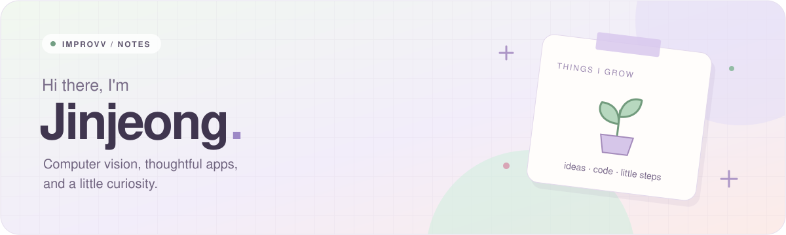

 

 

## 🌱 About Me

- 🎓 Computer Engineering at **Hanbat National University** (expected graduation Feb 2027)
- 👀 Interested in **computer vision**
- 🦁 Managing projects and teams at **LIKELION**
- ✍️ Writing about what I learn at [howsitgoin.tistory.com](https://howsitgoin.tistory.com)
- ☄️ See all my work at my [portfolio](https://improvv.github.io/portfolio/)

 

## 🧸 Experience

| Period | What | Role |
| :-- | :-- | :-- |
| 2026.03 – present | 🦁 **LIKELION** | Manager · running projects and teams |
| 2026.01 – 2026.06 | 🔧 **Robert Bosch Korea** | Intern · Technical Sales |
| 2026 Capstone | 🏋️ **BPT** · AI posture analysis training app | Frontend, UI/UX Design & PM |

 

## 🔬 Ongoing Research

| Period | Project | Course |
| :-- | :-- | :-- |
| 2026.09 – present | **Lightweight Deep Learning for Resource-Constrained Environments** Pruning, quantization & knowledge distillation · analyzing EfficientSAM (CVPR 2024) · comparing model size, inference speed & segmentation performance | Internet of Things · Team Project |
| 2026.09 – present | **Null-Argument Tracking in Korean Multi-Turn Dialogue** Evaluation framework under speaker, addressee & discourse-entity shifts | Natural Language Processing · Team Project |

 

## 🍞 Projects

| Project | About | Stack |
| :-- | :-- | :-- |
| [**견주여행**](https://github.com/Gyeonju-Travel/FE) | Dog-friendly travel app for Gyeongju with map, schedules & stamps · **Released on the iOS App Store** · [App Store](https://apps.apple.com/kr/app/id6802208144) | `React Native` `Expo` `TypeScript` `Java` |
| [**WHS After Mate**](https://github.com/WHS-After-Mate/Backend) | Aftercare app for wellness clinic patients with LLM-powered daily guides & Q&A | `Node.js` `TypeScript` `Supabase` `OpenAI` |
| [**Connect to ETF**](https://github.com/improvv/connect-to-etf) | ETF Q&A chatbot PoC with RAG | `Python` `Streamlit` |
| [**도라에몽의 핑계빵**](https://github.com/improvv/doraemon-excuse-bread) | Typing game about exam-season excuses | `JavaScript` `Flask` |
| [**대전 빵사대**](https://github.com/improvv/daejeon-bakery-app) | Location-based bakery finder for Daejeon | `Flutter` `Dart` |

 

## 🛠️ Tech Stack

**Computer Vision & AI**

 

**App · Web · Etc.**

 

## 🐾 My Farm

 

## 🐍 Contribution Snake

<picture>
  <source media="(prefers-color-scheme: dark)" srcset="https://raw.githubusercontent.com/improvv/improvv/output/github-snake-dark.svg" />
  <source media="(prefers-color-scheme: light)" srcset="https://raw.githubusercontent.com/improvv/improvv/output/github-snake.svg" />
  
</picture>

 

