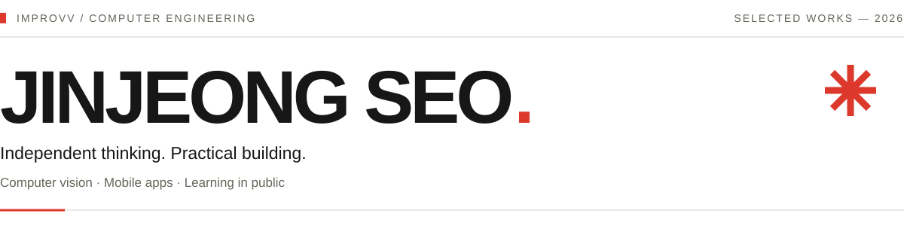

<picture>
  <source media="(prefers-color-scheme: dark)" srcset="./assets/profile-editorial-dark-v2.svg" />
  
</picture>

## 01 / About Me

- Computer Engineering at **Hanbat National University** (expected graduation Feb 2027)
- Interested in **computer vision**

## 02 / Selected Works

### WK—01 / 견주여행 · Gyeonju Travel
A dog-friendly Gyeongju travel app with personalized routes and maps. 
**PM · Frontend** — Shipped on the App Store after five TestFlight betas.

`React Native` `Expo` `TypeScript` · [App Store ↗](https://apps.apple.com/kr/app/id6802208144)

### WK—02 / BPT
An on-device AI fitness app that analyzes posture using an iPhone camera. 
**PM · UI/UX · Frontend** — Built app screens and workout flows; Capstone II in progress.

`Flutter` `Riverpod`

### WK—03 / MorseLingo
A webcam tool for practicing Korean Morse code through eye blinks. 
**Solo development** — Built a macOS prototype with eye tracking and Korean character conversion.

`Python` `OpenCV` `MediaPipe`

<b>More projects & hackathons</b>

| Project | Contribution / outcome |
| :-- | :-- |
| **RhythmMaMa** | PM · Rhythm system for a Quest 3 VR cooking game; in development. |
| **AI Firewall Validation** | Built 10 smart-home scenarios and 15 faulty rulesets for an AI validation pipeline. |
| [**Connect to ETF ↗**](https://github.com/improvv/connect-to-etf) | Solo RAG chatbot with ETF source citations and document comparisons. |
| **Silver Stop** | PM · YOLO pedestrian detection & stop control; **Gold Award**, Hanbat MOBI Camp. |
| [**WHS After Mate ↗**](https://github.com/WHS-After-Mate/Backend) | LIKELION hackathon · Clinic reservations and aftercare. |
| **Cliary** | Solo skincare tracking app. |
| [**도라에몽의 핑계빵 ↗**](https://github.com/improvv/doraemon-excuse-bread) | LIKELION Animal League · Typing game. |
| [**대전 빵사대 ↗**](https://github.com/improvv/daejeon-bakery-app) | Bakery map app for visitors to Daejeon. |

## 03 / Research Notes

- **Lightweight Deep Learning** — Studying pruning, quantization and distillation with EfficientSAM.
- **Null-Argument Tracking** — Evaluating Korean multi-turn dialogue under speaker and context shifts.

## 04 / Experience

- **LIKELION** · Study Group Organizer · `2026.03 – present`
- **Bosch Korea** · Technical Sales Intern · `2026.01 – 2026.06` — Pricing, sales data & SAP verification.

<b>Beyond code</b>

| Period | Experience |
| :-- | :-- |
| 2025.03 – 2026.08 | **THE HERALD · English-language newspaper reporter** |
| 2025.03 – 2026.08 | **BLACKSTONE · Vice President & bassist** — University band. |
| 2025.01 – 2025.12 | **Daejeon Family Center · Education mentor** — Mentored multicultural children. |
| 2025.07 – 2025.08 | **University of Wolverhampton** — English language study in the UK. |
| 2020.06 – 2023.02 | **Australia** — Working holiday & language study. |

## 05 / Tools & Technologies

**Computer Vision & AI**

    

**Frontend & Mobile**

    

## 06 / Off The Clock

